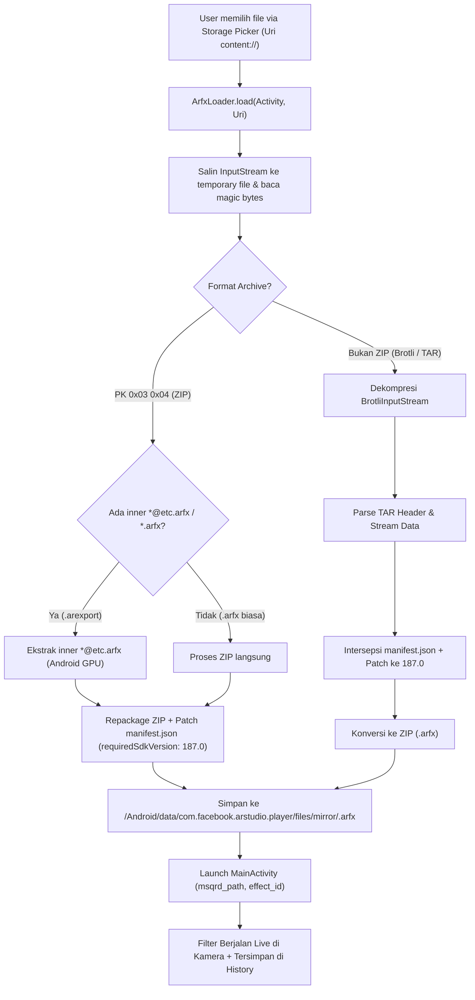

# DOKUMENTASI REVERSE ENGINEERING & MODIFIKASI META SPARK PLAYER

> **Proyek:** Meta Spark Studio Player Offline Filter Loader & Auto-Patcher  
> **Target Device:** Samsung Galaxy A54 5G (`SM-A546E`, Android 14 / One UI 6)  
> **Versi Target APK:** Meta Spark Studio Player v187 (`187.0.0.8.277`, `arm64-v8a`, `com.facebook.arstudio.player`) *(dimigrasi dari v175 `armeabi-v7a`)*  
> **Terakhir Diperbarui:** 12 November 2026  

---

## 1. Ringkasan Eksekutif (Executive Summary)

Aplikasi resmi **Meta Spark Player** (sebelumnya MSQRD Player) didesain hanya untuk menerima transfer filter secara real-time dari komputer desktop via kabel USB menggunakan protokol pairing Meta Spark Studio Desktop. 

Melalui proses reverse engineering dan patching ini, aplikasi telah dimodifikasi agar mampu:
1. **Memuat filter langsung dari penyimpanan lokal HP (Offline Storage)** tanpa komputer/USB melalui tombol picker interaktif.
2. **Mendukung format file universal**:
   - `.arexport` (bundle export dari Meta Spark Studio Desktop).
   - `.arfx` standar (ZIP archive).
   - `.arfx` raw dari CDN Instagram/Facebook (Brotli-compressed TAR / `.tar.br` / `.bin`).
3. **Mengatasi masalah *"Can't Load Project / A system issue prevented Meta Spark Studio Player from opening the project"*** secara otomatis menggunakan patcher in-memory `manifest.json` ke `"requiredSdkVersion": "187.0"`.
4. **Mengisi daftar riwayat (History List) secara otomatis**, sehingga setiap filter yang pernah dimuat dapat dibuka kembali kapan saja dari menu utama aplikasi dengan satu sentuhan.
5. **Pencarian Real-Time, Multi-Select (`Pilih`) On-Demand, & Batch Delete**: Menyaring daftar filter (`title` / nama file), memilih banyak item dengan pembatasan aman *Opsi A* (hanya item terlihat), dan menghapus sekaligus dari `mirror/` maupun `Download/ARFX/` (beserta panduan izin Android 14 `MANAGE_EXTERNAL_STORAGE`).

---

## 2. Struktur & Anatomi Format Filter Meta Spark

Dalam ekosistem Meta Spark AR, terdapat 4 jenis format container filter:

### A. Format `.arexport` (Spark Studio Export Package)
- Merupakan archive ZIP standar.
- **Isi struktur:**
  - `export.json`: Metadata proyek, editor version, dan mapping file target.
  - `<namaproyek>.arprojpkg`: Source package Meta Spark.
  - `<namaproyek>@etc.arfx`: Archive terkompresi tekstur format **ETC** khusus GPU Android.
  - `<namaproyek>@pvr.arfx`: Archive terkompresi tekstur format **PVR** khusus GPU iOS / Apple.
  - `<namaproyek>@uncompressed.arfx`: Versi tekstur tanpa kompresi GPU (fallback universal).
- **Aturan Ekstraksi:** Untuk platform Android, modul loader memprioritaskan ekstraksi `@etc.arfx`, diikuti `@uncompressed.arfx`, atau `.arfx` pertama yang ditemukan.

### B. Format `.arfx` Standar (ZIP Archive)
- Merupakan format internal efek yang siap dieksekusi oleh runtime camera core.
- Berisi file `manifest.json` di root (atau dalam satu sub-folder), folder `textures/`, `shaders/`, `scripts/`, `materials/`, dan assets 3D.

### C. Format `.arfx` CDN Instagram (`.tar.br` / `.bin` / raw `.arfx`)
- File filter yang di-download langsung dari server CDN Instagram atau Facebook Graph API.
- File ini **bukan ZIP**, melainkan archive **TAR** yang dikompresi dengan algoritma **Brotli** (magic bytes: `0xce 0xb2 0xcf` atau stream Brotli tanpa header ZIP `PK\x03\x04`).
- Header TAR berisi entri `./manifest.json` serta asset efek.

### D. Format `.arfxmirror` (Binary Mirror Stream)
- Format internal proprietary Meta yang dikirim melalui ADB reverse proxy USB. Menggunakan format binary data input (`LX/1Rw`) dengan magic signature versioning.

---

## 3. Analisis Root Cause & Solusi Teknis

### Permasalahan 1: *"Can't Load Project: A system issue prevented Meta Spark Studio Player from opening the project"*

- **Gejala:** Saat memuat `.arexport` lama atau `.arfx` dari CDN Instagram, muncul dialog error sistem dan kamera kembali ke layar kosong.
- **Penyelidikan Logcat Native:**
  ```text
  com.facebook.cameracore.common.exception.EffectsFrameworkException: Failed to load effect: This SDK version is not supported: 78.0
  com.facebook.cameracore.common.exception.EffectsFrameworkException: Failed to load effect: This SDK version is not supported: 120.0
  com.facebook.cameracore.common.exception.EffectsFrameworkException: Failed to load effect: This SDK version is not supported: 131.0
  ```
- **Penyebab Utama:**
  Engine render C++ native (`libdistractmerged.so` dan `libgraphicsengine-arengineservices-alleffectservicehost-native.so`) membaca `manifest.json` dan memverifikasi atribut `"requiredSdkVersion"`. Player menolak filter yang versi SDK-nya tidak sesuai dengan batas binary engine yang terpasang.
- **Solusi Permanen (`v187`):**
  `ArfxLoader` secara otomatis mengintersepsi `manifest.json` di dalam ZIP/TAR dan menimpa string:
  `"requiredSdkVersion": "187.0"` sebelum file diserahkan ke camera core engine (pada basis v175 sebelumnya digunakan `"175.0"`).

---

### Permasalahan 2: Daftar Efek, Pencarian, & Penghapusan Massal di `EffectListActivity`

- **Penyelidikan Decompilasi Smali (`v187`):**
  - Pemuatan riwayat di `MsqrdEffectListFragment` ditangani AsyncTask `X/3hA.2.smali` cabang `:pswitch_1` (`LX/3dS` dengan list `A01` dan observer `LX/3d8` di `A00`; item individual menyimpan path pada `A04` dan judul pada `A03 -> A07`), sementara `:pswitch_0` dipakai oleh `EffectHistoryActivity`.
  - Player memindai file berakhiran `.arfx` / `.arfxmirror` / `.mirror` dari `/storage/emulated/0/Android/data/com.facebook.arstudio.player/files/mirror/` serta `/storage/emulated/0/Download/ARFX/` (catatan: Android 14 FUSE menyembunyikan/menolak hapus file eksternal di `Download/ARFX/` jika izin `MANAGE_EXTERNAL_STORAGE` tidak aktif).
- **Solusi Permanen (`ArfxLoader`, `ArfxListState`, & `ArfxListController`):**
  1. `ArfxLoader` langsung menyimpan output ter-patch ke `getExternalFilesDir("mirror") + "/" + cleanName + ".arfx"`.
  2. `ArfxListController` + `ArfxListState` menyisipkan search bar (`"Cari filter..."` + tombol `"✕"`), tombol `"Pilih"` on-demand (`CheckBox` `View.GONE` di mode normal agar *hold* tetap memunculkan `"Effect Properties"` / `"Delete"`), pembatasan *Opsi A* (`Pilih Semua` hanya item terlihat; perubahan query memangkas pilihan tersembunyi), penghapusan rekursif `.mirror*`, sinkronisasi `onItemDeleted` di `LX/3cP`, dan dialog `"Izin Akses File Diperlukan"` -> `"Buka Pengaturan"` (`MANAGE_APP_ALL_FILES_ACCESS_PERMISSION`) + auto-retry di `onResume`.

---

### Permasalahan 3: Dialog *"Outdated Player"* / Update Versi

- **Gejala:** Dialog peringatan bahwa player sudah kedaluwarsa muncul saat membuka efek tertentu.
- **Solusi:**
  Patch smali pada `BaseEffectFragment.smali` untuk melewati pemeriksaan dialog versi kedaluwarsa (`isPlayerOutdated`).

---

## 4. Implementasi Modul Java (`ArfxLoader`, `ArfxListState`, & `ArfxListController`)

Modul Java kustom yang di-inject ke dalam `smali_classes4/com/facebook/arstudio/player/`:
- **Filter Loader & Patcher:** [`build_loader/src/com/facebook/arstudio/player/ArfxLoader.java`](file:///d:/RAKA%20KUSWANTO/1.%20PROJECTS/OTHER/REVERSE%20ENGINEERING/MetaSparkStudio/build_loader/src/com/facebook/arstudio/player/ArfxLoader.java) (`TARGET_SDK_VERSION = "187.0"`)
- **State Pencarian & Multi-Select:** [`build_loader/src/com/facebook/arstudio/player/ArfxListState.java`](file:///d:/RAKA%20KUSWANTO/1.%20PROJECTS/OTHER/REVERSE%20ENGINEERING/MetaSparkStudio/build_loader/src/com/facebook/arstudio/player/ArfxListState.java) + [`ArfxListStateTest.java`](file:///d:/RAKA%20KUSWANTO/1.%20PROJECTS/OTHER/REVERSE%20ENGINEERING/MetaSparkStudio/build_loader/test/com/facebook/arstudio/player/ArfxListStateTest.java)
- **Controller UI & Batch Delete:** [`build_loader/src/com/facebook/arstudio/player/ArfxListController.java`](file:///d:/RAKA%20KUSWANTO/1.%20PROJECTS/OTHER/REVERSE%20ENGINEERING/MetaSparkStudio/build_loader/src/com/facebook/arstudio/player/ArfxListController.java)

### Alur Kerja `ArfxLoader`:


---

## 5. Hooking & Titik Injeksi Smali (`v187`)

### A. Picker, Lifecycle, & Search/Multi-Select UI Hooks
- **`EffectListActivity.smali`**:
  - `onCreate`: Menyisipkan tombol `"PILIH FILE ARFX (STORAGE)"` (`btn_pick_arfx`) dan memanggil `ArfxListController.attachToActivity(p0)`.
  - `onResume`: Memanggil `ArfxListController.onResume(p0)` (termasuk auto-retry hapus `Download/` setelah izin *All Files Access* diberikan).
  - `onActivityResult`: Menangani request code `0x7123` dan memanggil `ArfxLoader.load(p0, v3)`.
- **`X/3Yt.1.smali`**: Memanggil `ArfxListController.attachToActivity(v3)` saat inisialisasi header tombol picker.
- **`X/3hA.2.smali`**:
  - `:pswitch_1` (`MsqrdEffectListFragment` saja): Memanggil `ArfxListController.onEffectsLoaded(v2)` pada objek koleksi `LX/3dS` sebelum update adapter.
  - `LX/3cP`: Memanggil `ArfxListController.onItemDeleted(path)` saat single-delete bawaan dijalankan.
- **`X/3dT.2.smali` & `X/3dV.2.smali`**: Melepas `final` pada `onCreateViewHolder`, membungkus item dengan `CheckBox` on-demand (`wrapItemView`), membuka wrapper sebelum cast `LX/3ff`/`LX/4Uu` (`unwrapContentView`), dan men-sync tampilan seleksi via `bindItemView`.
- **`X/3cg.3.smali` & `X/3dY.2.smali`**: `AXM` men-toggle pilihan saat `isSelectionMode()` aktif; `onLongClick` mengembalikan `true` saat mode pilih agar menu popover tidak mengganggu.

### B. Launching Kamera (`MainActivity.smali`)
- **Lokasi File:** `arstudio-decompiled/smali_classes2/com/facebook/arstudio/player/MainActivity.smali`
- Parameter Intent yang diproses:
  - `msqrd_path`: Path absolut file filter (`/storage/.../mirror/<Name>.arfx`).
  - `effect_id`: Nama unik effect untuk caching & tracking.

### C. Android Manifest (`AndroidManifest.xml`)
- `android:debuggable="false"` (wajib `false` pada build `v187` `arm64-v8a` agar berjalan bersih di One UI 6 / Android 14 tanpa dialog kompatibilitas).
- `android:requestLegacyExternalStorage="true"`.
- Permission: `CAMERA`, `RECORD_AUDIO`, `READ_EXTERNAL_STORAGE`, `WRITE_EXTERNAL_STORAGE`, `MANAGE_EXTERNAL_STORAGE`.

---

## 6. Prosedur Rebuild, Sign, dan Instalasi (Cheatsheet CLI)

Semua langkah eksekusi dilakukan dari direktori kerja:
`d:\RAKA KUSWANTO\1. PROJECTS\OTHER\REVERSE ENGINEERING\MetaSparkStudio`

### 1. Jalankan Unit Test `ArfxListStateTest`:
```powershell
New-Item -ItemType Directory -Force "build_loader\test_bin" | Out-Null
javac -source 8 -target 8 -d "build_loader\test_bin" "build_loader\src\com\facebook\arstudio\player\ArfxListState.java" "build_loader\test\com\facebook\arstudio\player\ArfxListStateTest.java"
java -cp "build_loader\test_bin" com.facebook.arstudio.player.ArfxListStateTest
```

### 2. Kompilasi Seluruh Modul Java ke DEX:
```powershell
javac -source 8 -target 8 -cp "C:\Users\TOS-46\AppData\Local\Android\Sdk\platforms\android-34\android.jar;brotli-dec.jar" -d "build_loader\bin" (Get-ChildItem "build_loader\src\com\facebook\arstudio\player\*.java").FullName

& "C:\Users\TOS-46\AppData\Local\Android\Sdk\build-tools\34.0.0\d8.bat" --min-api 16 --lib "C:\Users\TOS-46\AppData\Local\Android\Sdk\platforms\android-34\android.jar" --output "build_loader\dex_out" (Get-ChildItem -Recurse "build_loader\bin" -Filter "*.class").FullName "brotli-dec.jar"
```

### 3. Konversi DEX ke Smali:
```powershell
jar -cf dummy.apk -C "build_loader\dex_out" classes.dex
java -jar apktool_2.12.1.jar d -r -f dummy.apk -o dummy_decoded
Copy-Item -Recurse -Force "dummy_decoded\smali\*" "arstudio-decompiled\smali_classes4\"
```

### 4. Rebuild & Sign APK Mod (`build.bat`):
```powershell
.\build.bat
```
*(Menjalankan `apktool_2.12.1.jar b arstudio-decompiled -o arstudio-modded.apk` dan `uber-apk-signer-1.3.0.jar --allowResign --overwrite` dengan `my-debug.keystore`.)*

### 5. Install ke HP via ADB:
```powershell
adb -s 192.168.1.32:<port> install -r arstudio-modded.apk
```

---

## 7. Direktori Kunci & Kredensial

| Komponen | Nilai / Lokasi |
| :--- | :--- |
| **Keystore File** | `my-debug.keystore` (Root direktori) |
| **Keystore Alias** | `mykey` |
| **Keystore & Key Pass** | `123456` |
| **Subject Keystore** | `CN=raka kuswanto` |
| **App External Mirror Dir** | `/storage/emulated/0/Android/data/com.facebook.arstudio.player/files/mirror/` |
| **App Public Download Dir** | `/storage/emulated/0/Download/ARFX/` (memerlukan `MANAGE_EXTERNAL_STORAGE` di Android 14) |
| **App Internal Cache Dir** | `/data/data/com.facebook.arstudio.player/cache/` |
| **Source Java Loader & List** | `build_loader/src/com/facebook/arstudio/player/` (`ArfxLoader.java`, `ArfxListState.java`, `ArfxListController.java`) |
| **Decompiled Smali Root** | `arstudio-decompiled/` (`v187` `arm64-v8a`) |
| **Final Modded APK** | `arstudio-modded.apk` |

---

## 8. Panduan Troubleshooting Cepat

1. **Error: `INSTALL_FAILED_UPDATE_INCOMPATIBLE`**
   * *Penyebab:* Tanda tangan keystore APK yang terpasang berbeda dengan APK baru.
   * *Solusi:* Gunakan flag `--allowResign --overwrite` pada `uber-apk-signer` dengan `my-debug.keystore`, atau uninstall versi lama terlebih dahulu: `adb uninstall com.facebook.arstudio.player`.

2. **Error: `adb device offline` atau Port Berubah**
   * *Penyebab:* Fitur Wireless Debugging Android 14 merotasi port secara dinamis saat Wi-Fi reconnect atau toggle dimatikan.
   * *Solusi:* Jalankan `adb mdns services` untuk melihat port terbaru, lalu jalankan `adb -s 192.168.1.32:<port_baru> ...`.

3. **Filter Tidak Muncul Efeknya (Hanya Kamera Polos)**
   * *Penyebab:* File `.arexport` dibuat untuk iOS saja (`*@pvr.arfx`) tanpa versi Android (`*@etc.arfx` atau `@uncompressed.arfx`).
   * *Solusi:* Pastikan proyek Spark Studio diekspor dengan menargetkan Android, atau ekstrak dan simpan varian uncompressed.

4. **Filter di `Download/ARFX/` Gagal Dihapus atau Hilang (Android 14 FUSE)**
   * *Penyebab:* Izin *Akses Semua File* (`MANAGE_EXTERNAL_STORAGE`) belum aktif sehingga Android 14 menyembunyikan/memblokir `File.delete()` terhadap file publik milik aplikasi lain.
   * *Solusi:* Tekan **"Buka Pengaturan"** pada dialog `"Izin Akses File Diperlukan"`, aktifkan izin untuk Meta Spark Player, lalu kembali ke aplikasi (penghapusan tertunda otomatis dijalankan ulang di `onResume`).

---

## 9. Reverse Engineering Instagram GraphQL & CDN API

Selain modifikasi lokal pada APK Android, protokol komunikasi Instagram dieksplorasi secara mendalam untuk mendukung pengunduhan langsung dan penjelajahan galeri filter AR:

1. **Endpoint GraphQL:** `https://i.instagram.com/api/v1/wwwgraphql/ig/query/`
2. **Kueri Resmi yang Ditemukan:**
   - `IGAREffectsGalleryCategoriesQuery` (`336239785817217212229034758422`): Mengambil 8 kategori galeri resmi (`TRENDING`, `FOR_YOU`, `APPEARANCE`, `STUDIO`, `GAMES`, `HUMOR`, `SPECIAL_EFFECTS`, `SAVED`).
   - `IGAREffectCollectionQuery` (`224196792816793989860755450137`): Mengambil daftar efek per kategori dengan URL CDN langsung, hash MD5, dan metadata manifest.
   - `IGAREffectsByIdQuery` (`221300837212613742979169665279`): Query audit mendalam untuk memeriksa kapabilitas hardware, versi SDK asli, dan ukuran file.
3. **Format Kompresi CDN:** File `.bin` dari CDN Instagram dikompresi dengan **Brotli TAR** (`TAR_BROTLI`). `spark_filter_manager.py` secara otomatis mendekompresi Brotli, mem-patch `requiredSdkVersion: "175.0"` pada `manifest.json`, dan membungkusnya ke ZIP `.arfx`.

---

## 10. Indeks Dokumentasi Teknis Terperinci (`docs/`)

Untuk pembahasan arsitektur mendalam setiap modul, silakan merujuk ke dokumen terpisah pada folder [`docs/`](docs/):

- 📖 **[docs/01_arsitektur_dan_format_filter.md](docs/01_arsitektur_dan_format_filter.md)**: Analisis format `.arexport`, `.arfx`, Brotli TAR, dan skema `manifest.json`.
- 📖 **[docs/02_reverse_engineering_android_player.md](docs/02_reverse_engineering_android_player.md)**: Titik injeksi Smali, C++ Native Engine, dan implementasi `ArfxLoader.java`.
- 📖 **[docs/03_reverse_engineering_instagram_graphql.md](docs/03_reverse_engineering_instagram_graphql.md)**: Parameter kueri GraphQL, bypass signature, dan penanganan error respons.
- 📖 **[docs/04_panduan_spark_filter_manager.md](docs/04_panduan_spark_filter_manager.md)**: Arsitektur tool CLI, normalisasi font Unicode NFKD, katalog `informasi.json`, dan 9 perintah operasi.
- 📖 **[docs/05_rebuild_sign_and_deployment.md](docs/05_rebuild_sign_and_deployment.md)**: Panduan rebuild APK, d8 DEX compiler, keystore signing, dan ADB Wireless.

---
*Dokumentasi ini dibuat untuk referensi pemeliharaan, pengembangan fitur lanjutan, dan reproduksi lingkungan build secara instan tanpa perlu reverse engineering ulang.*
