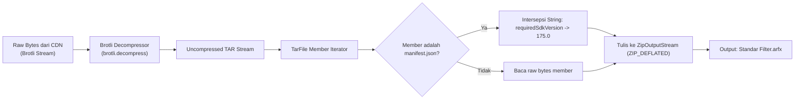

# 01. Arsitektur & Anatomi Format Filter Meta Spark

Dokumen ini menjelaskan struktur internal, format container, serta algoritma kompresi aset efek Augmented Reality (AR) di ekosistem Meta Spark Studio dan platform Instagram.

---

## 1. Perbandingan Format Container Filter

Dalam ekosistem Meta Spark AR, file filter didistribusikan dalam beberapa format tergantung tahap pembuatan dan platform target:

| Format File | Tipe Container | Magic Bytes / Header | Tujuan Penggunaan |
| :--- | :--- | :--- | :--- |
| **`.arexport`** | ZIP Archive | `50 4B 03 04` (`PK\x03\x04`) | Bundle ekspor dari Meta Spark Studio Desktop untuk publikasi. Berisi varian GPU untuk Android dan iOS. |
| **`.arfx` Standar** | ZIP Archive | `50 4B 03 04` (`PK\x03\x04`) | Format siap jalan runtime player/kamera. Berisi `manifest.json` langsung di root. |
| **`.arfx` CDN Instagram** | TAR Archive terkompresi Brotli | Stream Brotli (biasanya berakhiran `.bin` atau raw URL) | Format transfer cepat jaringan CDN Instagram ke aplikasi mobile pengguna. |
| **`.arfxmirror`** | Binary Proprietary Meta | Format internal stream `LX/1Rw` | Format transfer USB mirror real-time dari Spark Studio Desktop via ADB. |

---

## 2. Anatomi Paket `.arexport`

File `.arexport` adalah file ZIP terkompresi yang membungkus beberapa varian build platform:

```text
ProjectFilter.arexport (ZIP Archive)
├── export.json                 # Metadata proyek & mapping aset
├── ProjectFilter.arprojpkg      # Sumber proyek editor
├── ProjectFilter@etc.arfx       # Khusus GPU Android (Kompresi tekstur ETC)
├── ProjectFilter@pvr.arfx       # Khusus GPU Apple / iOS (Kompresi tekstur PowerVR)
└── ProjectFilter@uncompressed.arfx # Tekstur mentah RGBA (Universal Fallback)
```

### Prioritas Ekstraksi untuk Android:
Saat file `.arexport` dibuka di perangkat Android (baik oleh `ArfxLoader.java` maupun `spark_filter_manager.py`), algoritma parser mencari varian internal dengan urutan prioritas:
1. `*@etc.arfx` (Tekstur GPU paling efisien di Android)
2. `*@uncompressed.arfx` (Kompatibel dengan semua jenis chipset)
3. File `.arfx` pertama yang ditemukan di dalam archive.

---

## 3. Anatomi Format `.arfx` Standar

File `.arfx` adalah archive ZIP yang langsung dibaca oleh native camera engine C++ (`libdistractmerged.so`):

```text
Filter.arfx (ZIP Archive)
├── manifest.json               # Konfigurasi versi SDK, fitur AR, dan deklarasi shader
├── textures/                   # File tekstur (.png, .ktx, .etc)
├── shaders/                    # File shader GLSL / Spark SL (.glsl, .sparksldf)
├── materials/                  # Definisi material 3D
├── scripts/                    # Skrip JavaScript (Spark AR JS API)
└── blocks/                     # Sub-graph visual shader / Spark blocks
```

---

## 4. Anatomi Format CDN Instagram (`.bin` / Brotli TAR)

Instagram menyimpan filter di server CDN (misal: `instagram.fcgk6-3.fna.fbcdn.net`) dalam format biner yang sangat terkompresi:

1. **Kompresi Lapisan Luar**: Algoritma **Brotli** (Google Brotli compression).
2. **Container Lapisan Dalam**: **TAR archive** (Tape Archive).
3. **Isi TAR**:
   - `./manifest.json`
   - `./textures/`
   - `./shaders/`
   - File aset lainnya tanpa kompresi ZIP ganda.

### Pipeline Konversi Brotli TAR ke `.arfx` (Standard ZIP):


> [!WARNING]
> **Deteksi File Palsu (Thumbnail vs Payload):**  
> Endpoint Instagram GraphQL kadang mengembalikan URL preview gambar (`.jpg` / `.png`) jika parameter query tidak lengkap. Parser wajib memeriksa 4 byte pertama: jika diawali dengan `FF D8 FF` (JPEG) atau `89 50 4E 47` (PNG), file tersebut adalah thumbnail profil/preview dan bukan paket filter.

---

## 5. Skema & Spesifikasi `manifest.json`

File `manifest.json` adalah manifest deklaratif yang wajib ada di setiap filter AR Meta Spark.

### Contoh Struktur `manifest.json`:
```json
{
  "version": 1,
  "requiredSdkVersion": "153.0",
  "capabilities": [
    {
      "name": "faceTracker",
      "config": {
        "minVersion": 10,
        "maxFaces": 5
      }
    },
    {
      "name": "skinSmoothing"
    },
    {
      "name": "visualShaders"
    },
    {
      "name": "instruction",
      "config": {
        "dynamic": {
          "tokens": ["tap_to_change", "tap_and_slide_to_change"]
        }
      }
    }
  ],
  "additionalEnabledChanges": []
}
```

### Elemen-Elemen Kritis:

1. **`requiredSdkVersion`**:  
   Menentukan versi Meta Spark Studio minimum yang digunakan untuk membangun filter. Jika versi ini berada di luar rentang yang diizinkan oleh versi player yang terpasang, player akan melemparkan exception native:
   `EffectsFrameworkException: This SDK version is not supported`.
   **Solusi:** Patch string ini menjadi `"requiredSdkVersion": "175.0"`.

2. **`capabilities`**:  
   Daftar hardware & software engine features yang diperlukan oleh filter. Terdapat lebih dari 24 kapabilitas utama:
   - `faceTracker` & `faceTracker3D`: Pelacakan posisi dan rotasi wajah.
   - `exposeFaceTracker96`: 96 titik koordinat landmark wajah real-time.
   - `faceWarp`: Deformasi mesh wajah 3D.
   - `skinSmoothing`: Filter retouching / penghalus tekstur kulit.
   - `hairSegmentation`: Segmentasi warna dan area rambut.
   - `segmentation`: Pemotongan background manusia (portrait mode).
   - `worldTracker`: Plane detection / peletakan objek 3D di lantai atau meja.
   - `visualShaders` & `visualShadersSdf`: Shader prosedural berbasis grafis.
   - `instruction`: Instruksi interaktif di layar (misal: "Tap to change").
