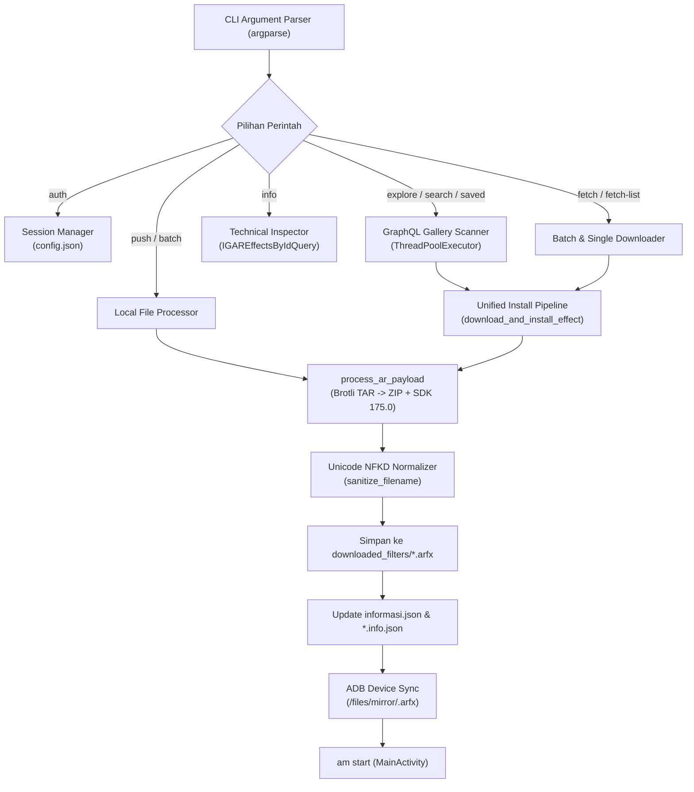

# 04. Panduan Lengkap Spark Filter Manager CLI

Dokumen ini merupakan panduan teknis dan operasional untuk alat bantu baris perintah (CLI) [`spark_filter_manager.py`](file:///d:/RAKA%20KUSWANTO/1.%20PROJECTS/OTHER/REVERSE%20ENGINEERING/MetaSparkStudio/spark_filter_manager.py).

---

## 1. Arsitektur Internal CLI Tool

`spark_filter_manager.py` dirancang secara modular untuk menangani seluruh siklus hidup filter AR:



---

## 2. Fitur-Fitur Kunci Sistem

### A. Algoritma Normalisasi Nama File (Unicode NFKD)
Banyak filter AR di Instagram menggunakan karakter Unicode unik (misal font matematika tebal `Cinematic 𝐇𝐃`, karakter miring, atau emoji). Karakter ini dapat menyebabkan error encoding konsol Windows (`charmap codec can't encode`) atau menghasilkan nama file ilegal di filesystem.

Fungsi `sanitize_filename`:
1. Memperbaiki representasi surrogate pair UTF-16 (`fix_surrogates`).
2. Menerapkan normalisasi **NFKD** (*Compatibility Decomposition*) untuk mengonversi simbol matematika Unicode ke representasi ASCII standar (`𝐇𝐃` -> `HD`).
3. Membersihkan karakter terlarang Windows/Linux: `\ / : * ? " < > |`.
4. Mencegah nama file reserved Windows (`CON`, `PRN`, `AUX`, `NUL`, `COM1-9`, `LPT1-9`).

### B. Katalog Metadata Otomatis (`informasi.json`)
Setiap filter yang berhasil diunduh dicatat ke dua target:
1. `<NamaFilter>.info.json`: Metadata spesifik individual.
2. `informasi.json`: Master database katalog seluruh filter yang mencatat ID, judul bersih, nama file, kreator, versi SDK asli, versi SDK hasil patch (175.0), ukuran file, MD5 hash, tanggal pengunduhan, dan direct CDN download URL.

### C. Manajemen Sesi Aman (`config.json`)
Sesi cookie `sessionid` Instagram disimpan secara lokal di `config.json`. File ini otomatis diabaikan oleh `.gitignore` sehingga aman dari kebocoran ke repository publik. Tampilan di terminal selalu disamarkan (contoh: `123456...abcd`).

---

## 3. Referensi Perintah Baris Perintah (CLI Commands)

### 1. Perintah: `auth` (Manajemen Sesi Akun)
```bash
# Menyimpan cookie sessionid akun sekunder
python spark_filter_manager.py auth set "12345678%3A..."

# Memeriksa status sesi tersimpan saat ini
python spark_filter_manager.py auth show

# Menguji apakah sesi aktif via live ping GraphQL ke server Meta
python spark_filter_manager.py auth check

# Menghapus sesi tersimpan dari konfigurasi
python spark_filter_manager.py auth clear
```

---

### 2. Perintah: `explore` (Jelajah Galeri Resmi)
```bash
# Menampilkan 8 daftar kategori resmi galeri Instagram
python spark_filter_manager.py explore --list-categories

# Menjelajahi kategori tertentu (default: TRENDING)
python spark_filter_manager.py explore TRENDING
python spark_filter_manager.py explore STUDIO
python spark_filter_manager.py explore GAMES

# Unduh filter berdasarkan nomor index pada tabel
python spark_filter_manager.py explore TRENDING --download 1
python spark_filter_manager.py explore TRENDING --download 1,3,5
python spark_filter_manager.py explore TRENDING --download 1-5

# Unduh semua filter dalam kategori
python spark_filter_manager.py explore GAMES --download-all

# Ekspor daftar efek ke file teks untuk dipakai di fetch-list
python spark_filter_manager.py explore TRENDING --save-list trending.txt
```

---

### 3. Perintah: `search` (Pencarian Kata Kunci)
Pencarian berjalan secara paralel pada semua kategori menggunakan `ThreadPoolExecutor`:
```bash
# Cari di seluruh kategori galeri
python spark_filter_manager.py search "iphone"

# Cari hanya pada kategori tertentu
python spark_filter_manager.py search "vintage" --category STUDIO

# Cari dan langsung unduh hasil nomor 1
python spark_filter_manager.py search "aesthetic" --download 1

# Ekspor hasil pencarian
python spark_filter_manager.py search "glitch" --save-list glitch_filters.txt
```

---

### 4. Perintah: `saved` (Filter Bookmark Akun)
```bash
# Tampilkan seluruh filter yang di-bookmark pada akun Instagram yang login
python spark_filter_manager.py saved

# Unduh semua filter yang tersimpan ke HP
python spark_filter_manager.py saved --download-all

# Ekspor daftar tersimpan ke file
python spark_filter_manager.py saved --save-list koleksi_tersimpan.txt
```

---

### 5. Perintah: `info` (Audit Spesifikasi Teknis Efek)
Melakukan inspeksi menyeluruh tanpa perlu mengunduh file paket:
```bash
python spark_filter_manager.py info 703846377811561
python spark_filter_manager.py info "https://www.instagram.com/ar/470585988662298"
```
**Data yang Dihasilkan:**
- ID Efek & Judul Asli / Judul Normalisasi
- Kreator (@username)
- Versi SDK Asli & Target Patch (175.0)
- Ukuran Paket CDN & Ukuran Setelah Di-unpack
- Format Kompresi & MD5 Checksum
- Daftar Kapabilitas AR Hardware/Software lengkap dengan konfigurasi detailnya (misal: `maxFaces: 5`, token gesture).
- Direct CDN Download URL.

---

### 6. Perintah: `fetch` (Download Efek Tunggal)
```bash
# Unduh via URL dan langsung jalankan di kamera HP
python spark_filter_manager.py fetch "https://www.instagram.com/ar/703846377811561"

# Unduh via Effect ID dan beri nama kustom
python spark_filter_manager.py fetch 703846377811561 --name "Cinematic_Keren"

# Unduh dan simpan di History HP tanpa langsung membuka kamera
python spark_filter_manager.py fetch 703846377811561 --no-launch

# Unduh dan simpan lokal di PC saja (lewati upload ADB)
python spark_filter_manager.py fetch 703846377811561 --no-push
```

---

### 7. Perintah: `fetch-list` (Batch Download dari Daftar File Teks)
```bash
python spark_filter_manager.py fetch-list filters.txt --delay 2.0 --launch-last
```
**Format File Teks yang Didukung:**
```text
# Baris komentar diawali tanda pagar
https://www.instagram.com/ar/703846377811561
470585988662298, Selfie No Monkey
https://instagram.../filter.bin | Vintage Cinema
```

---

### 8. Perintah: `push` & `batch` (File Lokal PC)
```bash
# Push 1 file lokal .arexport atau .arfx
python spark_filter_manager.py push "C:/filters/test.arexport" --name "MyFilter"

# Batch import seluruh folder file filter lokal
python spark_filter_manager.py batch "C:/filters/folder_efek"
```
