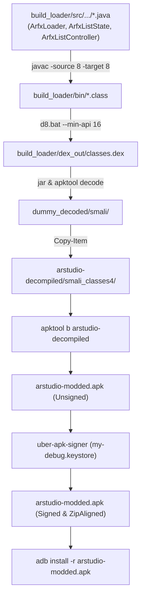

# 05. Panduan Rebuild, Signing & Deployment

Dokumen ini menjelaskan prosedur lengkap kompilasi ulang kode Java loader, patching Smali, perakitan APK dengan Apktool, penandatanganan kriptografis dengan Keystore, serta penyebaran ke perangkat Android fisik via ADB (USB & Wireless).

---

## 1. Prasyarat Lingkungan Pengembangan

| Perangkat Lunak | Versi yang Dianjurkan | Catatan |
| :--- | :--- | :--- |
| **Java Development Kit (JDK)** | JDK 17 atau JDK 21 | Wajib untuk menjalankan `javac`, `jar`, dan `apktool`. |
| **Android SDK Platforms** | `android-34` (Android 14) | Lokasi tipikal: `C:\Users\<User>\AppData\Local\Android\Sdk\platforms\android-34\android.jar` |
| **Android Build-Tools** | `34.0.0` | Menyediakan kompiler DEX `d8.bat`. |
| **Apktool** | `2.12.1` | Disediakan langsung di repositori: `apktool_2.12.1.jar`. |
| **Uber APK Signer** | `1.3.0` | Disediakan langsung di repositori: `uber-apk-signer-1.3.0.jar`. |
| **Keystore Debug** | `my-debug.keystore` | Berada di root repositori (alias: `mykey`, sandi: `123456`). |

---

## 2. Alur Kerja Rebuild (Java -> DEX -> Smali -> APK)



---

## 3. Eksekusi Script Otomatis (`build.bat`)

Cara paling praktis untuk merakit ulang APK setelah melakukan modifikasi Smali adalah menjalankan file batch di root folder:

```cmd
build.bat
```

Script tersebut secara otomatis:
1. Menjalankan `apktool_2.12.1.jar b arstudio-decompiled -o arstudio-modded.apk`.
2. Menandatangani APK menggunakan `uber-apk-signer-1.3.0.jar` dengan parameter `--allowResign --overwrite`.

---

## 4. Eksekusi Manual Langkah demi Langkah (PowerShell)

### Langkah 0 (Opsional): Jalankan Unit Test `ArfxListStateTest`
```powershell
New-Item -ItemType Directory -Force "build_loader\test_bin" | Out-Null
javac -source 8 -target 8 -d "build_loader\test_bin" "build_loader\src\com\facebook\arstudio\player\ArfxListState.java" "build_loader\test\com\facebook\arstudio\player\ArfxListStateTest.java"
java -cp "build_loader\test_bin" com.facebook.arstudio.player.ArfxListStateTest
```

### Langkah 1: Kompilasi Ulang Seluruh Modul Java Player ke DEX
Jika Anda mengubah logika pada folder [`build_loader/src/com/facebook/arstudio/player/`](file:///d:/RAKA%20KUSWANTO/1.%20PROJECTS/OTHER/REVERSE%20ENGINEERING/MetaSparkStudio/build_loader/src/com/facebook/arstudio/player/) (`ArfxLoader.java`, `ArfxListState.java`, `ArfxListController.java`):

> [!NOTE]
> Skrip [`build_loader/compile_loader.bat`](file:///d:/RAKA%20KUSWANTO/1.%20PROJECTS/OTHER/REVERSE%20ENGINEERING/MetaSparkStudio/build_loader/compile_loader.bat) saat ini masih hanya mengompilasi `ArfxLoader.java` tanpa flag `-source 8 -target 8`. Gunakan perintah PowerShell di bawah ini agar seluruh kelas list controller ikut masuk ke DEX (perhatikan JDK lokal memakai `-source 8 -target 8`, bukan `--source 8`).

```powershell
# 1. Kompilasi seluruh Java source (Java 8 bytecode) ke .class
javac -source 8 -target 8 -cp "C:\Users\TOS-46\AppData\Local\Android\Sdk\platforms\android-34\android.jar;brotli-dec.jar" -d "build_loader\bin" (Get-ChildItem "build_loader\src\com\facebook\arstudio\player\*.java").FullName

# 2. Kompilasi .class dan library Brotli ke classes.dex (min-api 16)
& "C:\Users\TOS-46\AppData\Local\Android\Sdk\build-tools\34.0.0\d8.bat" --min-api 16 --lib "C:\Users\TOS-46\AppData\Local\Android\Sdk\platforms\android-34\android.jar" --output "build_loader\dex_out" (Get-ChildItem -Recurse "build_loader\bin" -Filter "*.class").FullName "brotli-dec.jar"
```

### Langkah 2: Disassemble DEX ke Smali & Sisipkan ke Target
```powershell
# Buat container dummy APK
jar -cf dummy.apk -C "build_loader\dex_out" classes.dex

# Decode classes.dex menjadi file Smali
java -jar apktool_2.12.1.jar d -r -f dummy.apk -o dummy_decoded

# Salin Smali ArfxLoader dan Brotli ke smali_classes4 proyek
Copy-Item -Recurse -Force "dummy_decoded\smali\*" "arstudio-decompiled\smali_classes4\"
```

### Langkah 3: Build APK dengan Apktool
```powershell
java -jar apktool_2.12.1.jar b arstudio-decompiled -o arstudio-modded.apk
```

### Langkah 4: Tanda Tangan Kriptografis (Signing)
```powershell
java -jar uber-apk-signer-1.3.0.jar --apks arstudio-modded.apk --ks my-debug.keystore --ksAlias mykey --ksPass 123456 --ksKeyPass 123456 --allowResign --overwrite
```

### Langkah 5: Instalasi ke HP via ADB
```powershell
adb install -r arstudio-modded.apk
```

---

## 5. Konfigurasi Wireless Debugging ADB (Android 14 / One UI 6)

Pada Samsung One UI 6 (Android 14), fitur *Wireless Debugging* merotasi nomor port secara dinamis setiap kali perangkat terhubung ulang ke jaringan Wi-Fi.

### Prosedur Deteksi Port Otomatis:
1. Pastikan opsi pengembang (*Developer Options*) dan *Wireless Debugging* aktif pada HP.
2. Cari port yang aktif via mDNS:
   ```powershell
   adb mdns services
   ```
   *Output contoh:*
   ```text
   adb-RRCW307CTQZ-V8dYOE._adb-tls-connect._tcp.  192.168.1.32:36247
   ```
3. Hubungkan ADB ke port yang terdeteksi:
   ```powershell
   adb connect 192.168.1.32:36247
   ```
4. Verifikasi status koneksi:
   ```powershell
   adb devices
   ```

---

## 6. Pemecahan Masalah Instalasi & Deployment

1. **Error: `INSTALL_FAILED_UPDATE_INCOMPATIBLE`**  
   * **Penyebab:** Tanda tangan keystore pada APK yang terpasang di HP berbeda dengan signature APK baru.
   * **Solusi:** Hapus aplikasi versi lama terlebih dahulu:
     ```powershell
     adb uninstall com.facebook.arstudio.player
     adb install -r arstudio-modded.apk
     ```

2. **Error: `AdbCommandRejectedException: device unauthorized`**  
   * **Penyebab:** Perangkat belum menyetujui dialog otorisasi RSA fingerprint PC.
   * **Solusi:** Buka layar HP dan centang *"Always allow from this computer"*, lalu tekan *Allow*.

3. **Folder Mirror Tidak Terbaca di Player:**  
   * Pastikan direktori `/storage/emulated/0/Android/data/com.facebook.arstudio.player/files/mirror/` telah dibuat:
     ```powershell
     adb shell mkdir -p /storage/emulated/0/Android/data/com.facebook.arstudio.player/files/mirror
     ```

4. **File di `Download/ARFX/` Hilang atau Gagal Dihapus (Android 14 FUSE):**  
   * *Penyebab:* Pada Android 14, file eksternal non-aplikasi di `/sdcard/Download/ARFX/` disembunyikan oleh FUSE / ditolak oleh `File.delete()` saat izin `MANAGE_EXTERNAL_STORAGE` tidak aktif.  
   * *Solusi:* Tekan **"Buka Pengaturan"** pada dialog `"Izin Akses File Diperlukan"` (atau aktifkan **Allow access to manage all files** / **Akses Semua File** di Info Aplikasi Android). Setelah kembali ke player, `ArfxListController.onResume` otomatis mencoba ulang penghapusan yang tertunda.

5. **Error `adb: more than one device/emulator` saat Wireless Debugging:**  
   * *Penyebab:* Perangkat yang sama sering terdaftar ganda (`192.168.x.x:<port>` dan `adb-..._adb-tls-connect._tcp`).  
   * *Solusi:* Sertakan serial target secara eksplisit dengan `-s`, misalnya:
     ```powershell
     adb -s 192.168.1.32:<port> install -r arstudio-modded.apk
     ```
