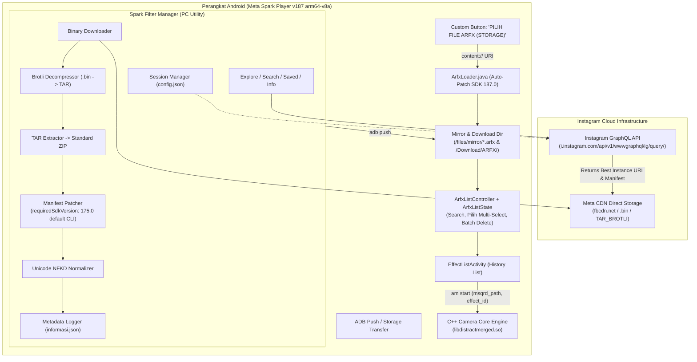

# Dokumentasi Pengetahuan Meta Spark & Instagram Reverse Engineering

Selamat datang di dokumentasi komprehensif proyek **Meta Spark Player Offline Loader & Instagram AR Filter Manager**.

Dokumentasi ini merangkum seluruh pengetahuan teknis, hasil *reverse engineering* binary C++/Smali Android, protokol GraphQL Instagram, algoritma dekompresi/repackaging format AR, hingga arsitektur otomatisasi CLI tool yang telah dibangun.

---

## 📚 Daftar Isi Dokumentasi

| Dokumen | Topik Pembahasan | Deskripsi Singkat |
| :--- | :--- | :--- |
| **[01. Arsitektur & Anatomi Format Filter](01_arsitektur_dan_format_filter.md)** | Format `.arexport`, `.arfx`, Brotli TAR, `.arfxmirror` | Struktur container, perbedaan tekstur GPU (ETC vs PVR), payload Brotli TAR CDN Instagram, serta skema `manifest.json`. |
| **[02. Reverse Engineering Android Player](02_reverse_engineering_android_player.md)** | Decompilasi APK v187, Smali Hooking, C++ Engine, Filter List UI | Analisis error `EffectsFrameworkException`, migrasi ke v187 (`arm64-v8a`), injeksi `ArfxLoader`, serta fitur Search, Multi-Select (`Pilih`), dan Batch Delete (`ArfxListController` & `ArfxListState`). |
| **[03. Reverse Engineering Instagram GraphQL](03_reverse_engineering_instagram_graphql.md)** | GraphQL Endpoints, Query Hashes, Parameter | Penemuan Query Doc ID (`IGAREffectsGalleryCategoriesQuery`, `IGAREffectCollectionQuery`, `IGAREffectsByIdQuery`), struktur respons, mitigasi thumbnail vs binary payload, dan autentikasi sesi. |
| **[04. Panduan Spark Filter Manager CLI](04_panduan_spark_filter_manager.md)** | Tool CLI, Normalisasi Nama, Katalog JSON | Arsitektur `spark_filter_manager.py`, algoritma normalisasi font Unicode NFKD, manajemen sesi lokal, katalog `informasi.json`, serta panduan lengkap 9 perintah CLI (`auth`, `explore`, `search`, `saved`, `info`, dll). |
| **[05. Rebuild, Signing & Deployment](05_rebuild_sign_and_deployment.md)** | Panduan Build APK, Unit Test & Konfigurasi ADB | Langkah kompilasi Java 8 (`-source 8 -target 8`) -> DEX -> Smali, unit test `ArfxListStateTest`, rebuild via Apktool, signing dengan `my-debug.keystore`, serta penanganan wireless debugging ADB pada One UI 6 / Android 14. |

---

## 🗺️ Gambaran Alur Sistem (End-to-End Architecture)

Diagram alir berikut mengilustrasikan bagaimana filter AR ditemukan di server Instagram, diunduh, dipatch versinya, dan dijalankan di Meta Spark Player:

---

## 💡 Filosofi Desain Proyek

1. **Zero-Cloud Dependency (Runtime Player)**: Modifikasi APK memastikan aplikasi player v187 (`187.0.0.8.277`, `arm64-v8a`) dapat berjalan 100% offline tanpa perlu koneksi internet atau login akun Meta untuk memuat dan mengelola efek dari memori HP.
2. **Backward & Forward Compatibility**: Penimpaan string in-memory pada `manifest.json` (`requiredSdkVersion: "187.0"` di `ArfxLoader.java`) membuka kembali filter lama agar kompatibel di engine native v187. *(Catatan: skrip CLI `spark_filter_manager.py` saat ini masih memakai target bawaan `175.0`.)*
3. **Safe Automation, Management & Integrity**: Pencarian real-time, multi-select *on-demand* (*Opsi A* — `Pilih Semua` & pruning hanya untuk item yang terlihat), batch delete aman beserta panduan izin `MANAGE_EXTERNAL_STORAGE` Android 14, serta pengambilan data Instagram via sesi lokal aman (`config.json` diabaikan git) dan normalisasi nama file Unicode.
