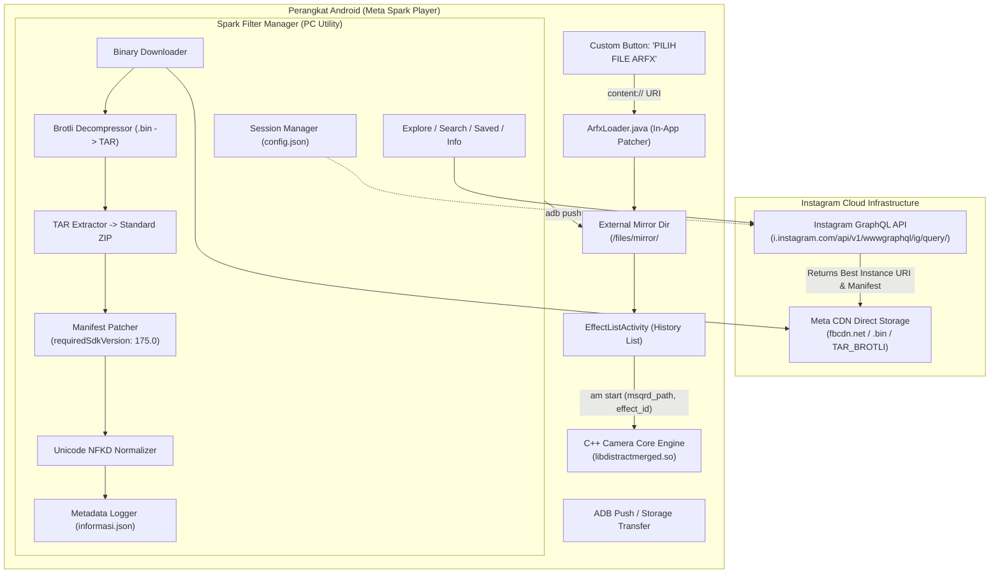

# Dokumentasi Pengetahuan Meta Spark & Instagram Reverse Engineering

Selamat datang di dokumentasi komprehensif proyek **Meta Spark Player Offline Loader & Instagram AR Filter Manager**.

Dokumentasi ini merangkum seluruh pengetahuan teknis, hasil *reverse engineering* binary C++/Smali Android, protokol GraphQL Instagram, algoritma dekompresi/repackaging format AR, hingga arsitektur otomatisasi CLI tool yang telah dibangun.

---

## 📚 Daftar Isi Dokumentasi

| Dokumen | Topik Pembahasan | Deskripsi Singkat |
| :--- | :--- | :--- |
| **[01. Arsitektur & Anatomi Format Filter](01_arsitektur_dan_format_filter.md)** | Format `.arexport`, `.arfx`, Brotli TAR, `.arfxmirror` | Struktur container, perbedaan tekstur GPU (ETC vs PVR), payload Brotli TAR CDN Instagram, serta skema `manifest.json`. |
| **[02. Reverse Engineering Android Player](02_reverse_engineering_android_player.md)** | Decompilasi APK, Smali Hooking, C++ Engine | Analisis penyebab error `EffectsFrameworkException`, injeksi Java `ArfxLoader`, integrasi Scoped Storage Android 14, dan otomatisasi daftar History (`mirror/`). |
| **[03. Reverse Engineering Instagram GraphQL](03_reverse_engineering_instagram_graphql.md)** | GraphQL Endpoints, Query Hashes, Parameter | Penemuan Query Doc ID (`IGAREffectsGalleryCategoriesQuery`, `IGAREffectCollectionQuery`, `IGAREffectsByIdQuery`), struktur respons, mitigasi thumbnail vs binary payload, dan autentikasi sesi. |
| **[04. Panduan Spark Filter Manager CLI](04_panduan_spark_filter_manager.md)** | Tool CLI, Normalisasi Nama, Katalog JSON | Arsitektur `spark_filter_manager.py`, algoritma normalisasi font Unicode NFKD, manajemen sesi lokal, katalog `informasi.json`, serta panduan lengkap 9 perintah CLI (`auth`, `explore`, `search`, `saved`, `info`, dll). |
| **[05. Rebuild, Signing & Deployment](05_rebuild_sign_and_deployment.md)** | Panduan Build APK & Konfigurasi ADB | Langkah kompilasi Java -> DEX -> Smali, rebuild via Apktool, signing dengan `my-debug.keystore`, serta penanganan wireless debugging ADB pada One UI 6. |

---

## 🗺️ Gambaran Alur Sistem (End-to-End Architecture)

Diagram alir berikut mengilustrasikan bagaimana filter AR ditemukan di server Instagram, diunduh, dipatch versinya, dan dijalankan di Meta Spark Player:

---

## 💡 Filosofi Desain Proyek

1. **Zero-Cloud Dependency (Runtime Player)**: Modifikasi APK memastikan aplikasi player dapat berjalan 100% offline tanpa perlu koneksi internet atau login akun Meta untuk memuat efek dari memori HP.
2. **Backward & Forward Compatibility**: Penimpaan string in-memory pada `manifest.json` (`requiredSdkVersion: 175.0`) membuka kembali ribuan filter lama (SDK 70.0 - 174.0) yang sebelumnya ditolak oleh engine native.
3. **Safe Automation & Integrity**: Pengambilan data dari Instagram mempergunakan endpoint resmi aplikasi Android dengan sesi terenkripsi aman di tingkat lokal (`config.json` diabaikan oleh git) serta normalisasi nama file Unicode untuk mencegah kerusakan filesystem Windows dan Linux.
